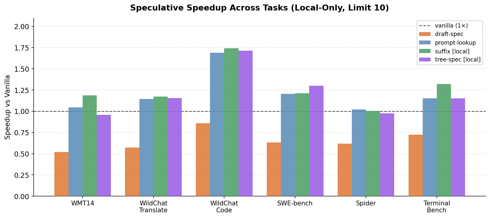

# LLM Serving Benchmark

[](https://github.com/stormckey/sd-bench/actions/workflows/tests.yml)

A Modal-based benchmark harness for comparing autoregressive decoding, prompt lookup, draft-model speculation, and suffix/tree speculative decoding on realistic language-model workloads.

- **Transformers implementation:** [`stormckey/transformers`](https://github.com/stormckey/transformers/tree/suffix-decoding)
- **Results:** [course evaluation](#results) and the [H100 follow-up](#follow-up-september-2026-fixed-tree-verification-on-h100); earlier exploratory runs in [`summary.md`](summary.md)
- **Project poster:** [`assets/index.pdf`](assets/index.pdf)

## What It Evaluates

The harness provides a common configuration, dataset, execution, and metrics layer for:

- `autoregressive`
- `draft_speculative`
- `prompt_lookup`
- `suffix_speculative`
- `tree_speculative`

Runs execute on Modal GPUs, load prompts from Hugging Face datasets or local JSONL, and write per-batch `raw.jsonl` records plus an aggregate `summary.json`. The primary throughput metric is `overall_tokens_per_second`; speculative methods also report proposed and accepted draft tokens.

## Reproducible Transformers Revisions

The benchmark installs the local checkout at `./transformers`, rather than the PyPI release. Use the setup helper to select the implementation required by an experiment:

| Profile | Branch | Pinned revision | Scope |
|---|---|---|---|
| `suffix` | [`suffix-decoding`](https://github.com/stormckey/transformers/tree/suffix-decoding) | [`76d60fa`](https://github.com/stormckey/transformers/commit/76d60fa5751e4d66423523b9d78680743ff666fd) | Suffix tree, candidate generator, generation integration, and cross-request cache |
| `tree-spec` | [`tree-spec-decoding`](https://github.com/stormckey/transformers/tree/tree-spec-decoding) | [`c66e13b`](https://github.com/stormckey/transformers/commit/c66e13b7ee10b7d630c4d5e2319b1f382e00cd2a) | Team-attributed tree-spec extension and incremental verifier |

```bash
# Default suffix-decoding experiments
./scripts/setup_transformers suffix

# Tree-spec experiments instead
./scripts/setup_transformers tree-spec
```

The helper clones the selected branch and checks out the exact detached revision. It refuses to overwrite an existing `./transformers` directory.

## Results

Final course evaluation (CMU 15-642, Spring 2026): `Qwen/Qwen3-8B` on one NVIDIA L40S via Modal, 10 prompts per
workload, batch size 1, greedy decoding (`do_sample=false`), local (per-request) caches only. Numbers are throughput relative to autoregressive decoding.

| Workload | Autoregressive (tok/s) | Draft model | Prompt lookup | Suffix (ours) | Tree-spec |
|---|---:|---:|---:|---:|---:|
| WMT14 | 33.8 | 0.52× | 1.05× | **1.19×** | 0.96× |
| WildChat translate | 34.8 | 0.57× | 1.14× | **1.17×** | 1.16× |
| WildChat code | 26.0 | 0.86× | 1.69× | **1.74×** | 1.72× |
| SWE-bench | 37.5 | 0.63× | 1.21× | 1.21× | **1.30×** |
| Spider | 41.0 | 0.62× | **1.02×** | 1.00× | 0.98× |
| TerminalBench | 37.8 | 0.72× | 1.15× | **1.32×** | 1.15× |



- Suffix decoding needs no draft model. It was the fastest method on 4 of 6 workloads and within 0.1× of the fastest
  on the other two, peaking at **1.74×** on WildChat code.
- The draft-model baseline (`Qwen/Qwen3-0.6B`) was slower than autoregressive decoding on every workload: it accepted
  more draft tokens per step, but each step also ran the second model.
- Data and plotting code: [`poster/gen_figures.py`](poster/gen_figures.py). The raw Modal artifacts behind these
  numbers were not committed, so treat them as reported results, not something CI reproduces.
- Earlier exploratory runs (50 prompts, different cache settings) reached higher peaks such as 2.14× on WMT14; they
  are kept in [`summary.md`](summary.md) for reference but are not the headline result.

## Follow-up (September 2026): fixed tree verification on H100

After the course I revisited the team's tree-spec path in
[`stormckey/transformers@tree-spec-fix`](https://github.com/stormckey/transformers/tree/tree-spec-fix/bench_tree_spec):

- **Correctness fix.** When the verifier accepted any branch other than the first one in flattened order, it kept the
  KV entries of rejected draft tokens and corrupted later steps. Verification now feeds the flattened tree with a 4D
  tree mask and depth-based position ids, then moves the accepted path's KV next to the prefix before cropping. In
  float32 every method now reproduces plain greedy decoding exactly (tests in `tests/generation/test_candidate_generator.py`).
- **Uncapped drafts.** A Qwen3-8B forward on H100 costs about the same for 1 or 129 query tokens, so the old draft-size
  cap discarded free verification work. The policy was tuned offline on a separate dev split with a simulator that
  replays greedy outputs and predicted tokens per forward within about 3%.

Setup: Qwen3-8B, one H100, bf16, batch size 1, greedy, up to 384 new tokens, 30 prompts per task; all methods run back
to back per prompt in rotated order; geometric-mean speedup over autoregressive decoding, recomputed from the raw
records in `results/qwen3-8b-h100-v3.json`.

| Task | Prompt lookup | Suffix | Tree (fixed) |
|---|---:|---:|---:|
| Code editing (CanItEdit) | 3.90× | 6.64× | **9.04×** |
| HumanEval | 1.69× | 1.85× | **1.93×** |
| GSM8K | 1.41× | 1.43× | **1.57×** |
| Chat (MT-Bench) | 1.11× | **1.15×** | 1.13× |
| **All** | 1.79× | 2.12× | **2.36×** |

Tree vs. suffix, paired per prompt: 1.11× (95% bootstrap CI 1.08–1.15), reproduced across two runs. These numbers use a
different GPU, tasks and output length from the course sweep above, so the two tables are not directly comparable.

## Quick Start

Requirements:

- Python 3.11+
- Git
- A Modal account for GPU runs

```bash
python3 -m venv .venv
source .venv/bin/activate
pip install -e .
./scripts/setup_transformers suffix
modal setup
```

Optional for gated Hugging Face models:

```bash
export HF_TOKEN=...
```

Run the default comparison suite on an L40S:

```bash
./scripts/bench compare default
```

Run one configuration directly:

```bash
modal run modal_app.py \
  --config-path configs/wmt14_qwen8b_suffix_fr_en.json \
  --gpu L40S
```

> Modal commands provision remote GPU resources and may incur charges. The local checks below do not run a model or require a GPU.

## No-GPU Validation

Validate all checked-in experiment configs and the deterministic dataset sampling logic:

```bash
PYTHONPATH=src python3 -m unittest discover -s tests -v
```

The adapter tests inject minimal mock Transformers modules, so this suite does not install the model library, download weights, or require CUDA. It validates configuration loading, deterministic dataset sampling, method registration, generation arguments, cache construction, and speculation accounting; it does not perform inference or verify the reported throughput.

## Comparison Suites

```bash
# Default WMT14 comparison
./scripts/bench compare default

# One-prompt smoke test of a suite
./scripts/bench compare wildchat --limit 1

# List all built-in suites
./scripts/bench compare --list
```

Built-in suites cover:

- WMT14 French-to-English translation
- WildChat translation and code prompts
- SWE-bench code-generation tasks
- Spider text-to-SQL
- TerminalBench command-line tasks

Example configurations live in [`configs/`](configs/). Most experiment changes only require editing a JSON file; common fields include `method`, `target_model`, `draft_model`, `prompt_source`, `max_new_tokens`, `limit`, `torch_dtype`, and method-specific options.

## Outputs

Each run writes:

- `raw.jsonl`: per-batch latency, token, memory, and speculation records
- `summary.json`: aggregate metrics and resolved configuration

Modal stores results under:

```text
/results/{experiment_name}/{method}/{timestamp}
```

For comparisons, retain the raw artifacts alongside the exact Transformers revision, configuration, GPU type, prompt seed, and prompt limit.

## Repository Layout

- `modal_app.py`: Modal entrypoint and remote environment
- `configs/`: experiment configurations
- `src/bench/`: configuration, datasets, method adapters, runner, and metrics
- `scripts/bench`: comparison CLI wrapper
- `tests/`: no-GPU config, dataset, and adapter tests
- `summary.md`: historical experiment notes and result tables
- `assets/`, `figures/`, `poster/`: project presentation artifacts

## Attribution

The Git history preserves individual authorship across the benchmark harness, poster work, suffix-decoding implementation, and team tree-spec extension. The personal Transformers fork mirrors team-authored branches without rewriting their commits; the project README distinguishes Chenhao Gao's suffix-decoding implementation history from later team contributions.
